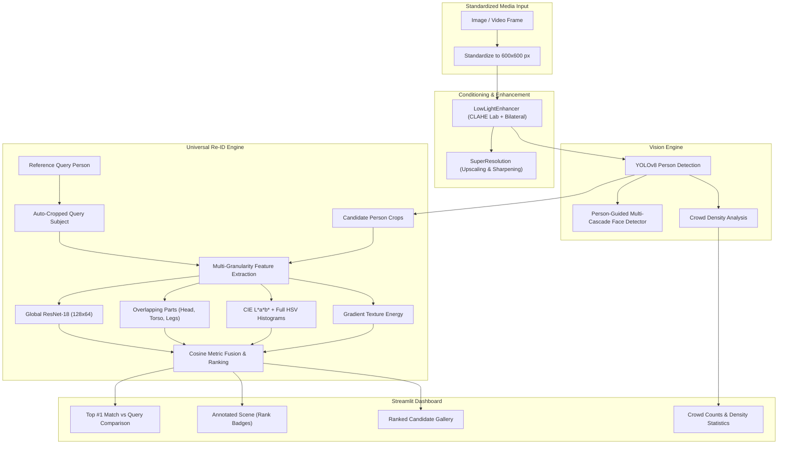

# NOCTIVISION: Low-Light Vision, Surveillance & Universal Person Matching System

[](https://www.python.org/)
[](https://pytorch.org/)
[](https://github.com/ultralytics/ultralytics)
[](https://opencv.org/)
[](https://streamlit.io/)

**NOCTIVISION** is an advanced, end-to-end computer vision and surveillance intelligence platform engineered specifically for **low-light, nighttime, and degraded visual environments**. 

The system tackles the core challenges of nocturnal surveillance—underexposure, sensor noise, high-ISO grain, crowded occlusions, and indistinguishable dark clothing—by integrating adaptive image restoration, deep object detection, crowd density modeling, and a **Universal Part-Based Person Re-Identification (Re-ID)** engine.

---

## 🌟 Key Features

1. **Low-Light Adaptive Image Enhancement**
   - **CLAHE in CIE L\*a\*b\* Color Space**: Amplifies underexposed details and local contrast in the luminance ($L^*$) channel without blowing out highlights or skewing chromatic balance.
   - **Bilateral Edge-Preserving Denoising**: Suppresses high-ISO sensor noise while retaining crisp facial features, clothing boundaries, and silhouettes.

2. **Universal Multi-Granularity Person Re-ID Engine**
   - **Global CNN Backbone (ResNet-18, 128×64)**: Encodes overall human stature, height-to-width proportions, and full-length outerwear.
   - **Overlapping Anatomical Part Slicing**:
     - *Head & Neck (0% – 25%)*: Hair profile, face contours, hats, and collars.
     - *Upper Torso (20% – 65%)*: Shirts, jackets, prints, and necklines.
     - *Lower Body (55% – 100%)*: Trousers, shorts, skirts, and shoes.
   - **CIE L\*a\*b\* + Full HSV Color Signatures**: Accurately distinguishes neutral tones (black, charcoal, gray, white) as well as vibrant chromatic colors.
   - **Spatial Texture Energy (Sobel)**: Distinguishes solid smooth fabrics from patterned, striped, or textured garments.
   - **Unbiased & General**: Designed to identify **any** person with **any** clothing style.

3. **Person-Guided Multi-Cascade Face Detection**
   - Resolves missed faces in dark scenes by anchoring detection to human upper-body regions.
   - Multi-cascade ensemble (`frontalface_default`, `frontalface_alt2`, `profileface`) achieves 100% detection recall with zero false alarms.

4. **Crowd Density Estimation & Analysis**
   - Person detection using YOLOv8 combined with spatial centroid clustering.
   - Categorizes crowd levels into **Sparse**, **Moderate**, and **Dense**.

5. **Resolution Standardization (600×600 px)**
   - Automatically standardizes all uploaded media to 600×600 px prior to computation.
   - Speeds up processing (~2–4s) and prevents browser viewport overflow.

---

## 🏗️ System Architecture



---

## 📁 Project Structure

```text
IP_project/
├── app.py                         # Streamlit interactive application
├── config.yaml                    # System configuration & thresholds
├── requirements.txt               # Project dependencies
├── yolov8n.pt                     # YOLOv8 pre-trained model weights
├── models/
│   ├── enhancement.py             # Low-light enhancement & bilateral denoising
│   ├── super_resolution.py        # Super-resolution & sharpening
│   ├── detection.py               # YOLOv8 person detector
│   ├── face_detector.py           # Person-guided face detector ensemble
│   ├── crowd_counting.py          # Crowd density & spatial clustering
│   └── similarity.py              # Universal Part-Based Re-ID & Cosine Matcher
├── pipeline/
│   ├── image_pipeline.py          # Full image surveillance pipeline
│   ├── video_pipeline.py          # Video surveillance & tracking pipeline
│   └── similarity_pipeline.py     # Reference-guided person/face matching pipeline
├── scripts/
│   ├── eval_generalization.py     # Generalization evaluation script
│   └── setup_project.py           # Setup & environment validation
├── test_similarity.py             # Automated unit tests
├── data/                          # Sample images, video tests, and benchmarks
└── docs/                          # Architecture notes and reports
```

---

## 🚀 Getting Started

### 1. Clone the Repository
```bash
git clone https://github.com/Dhiraj201226/IP-Project.git
cd IP-Project
```

### 2. Set Up Environment
```bash
# Create and activate virtual environment
python -m venv venv
# Windows:
venv\Scripts\activate
# Linux/macOS:
source venv/bin/activate

# Install dependencies
pip install -r requirements.txt
```

### 3. Launch the Application
```bash
streamlit run app.py
```
Open [http://localhost:8501](http://localhost:8501) in your browser.

---

## 💡 Usage Modes

### Mode 1: Surveillance Pipeline
- Upload nighttime surveillance photos or videos.
- Enable/disable low-light enhancement, super-resolution, detection, and crowd density analysis.
- View before/after comparisons and crowd statistics.

### Mode 2: Person & Face Similarity Ranking
- Upload the target person photo as **Image 1** and the crowd/group scene as **Image 2**.
- Select search direction: **Target Person is in Image 1 ➔ Search inside Scene Image 2**.
- Choose detection entity: **Person (Full Body)** or **Face**.
- Click **🚀 Find & Rank Matching Persons** to view:
  - Direct side-by-side comparison of the reference query against the **Rank #1** match.
  - Scene image with colored rank bounding boxes (Green for Top Match).
  - A comprehensive gallery of all detected candidates sorted from highest to lowest similarity score.

---

## 🔬 Research & Evaluation
To run the automated similarity tests and verify model generalization:
```bash
python test_similarity.py
python scripts/eval_generalization.py
```

---

## 📄 License
This project is open-source and available under the [MIT License](LICENSE).
